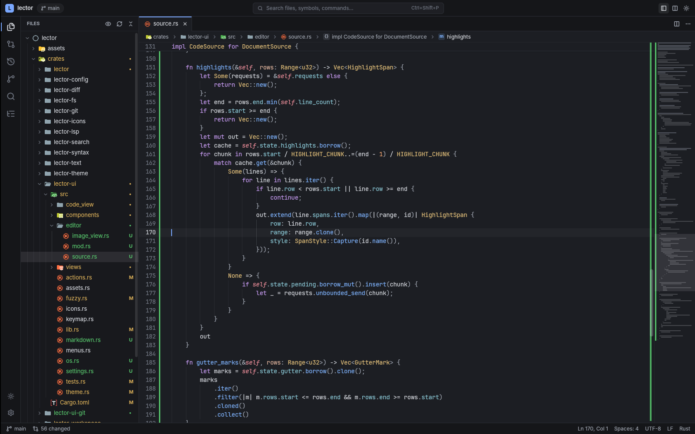
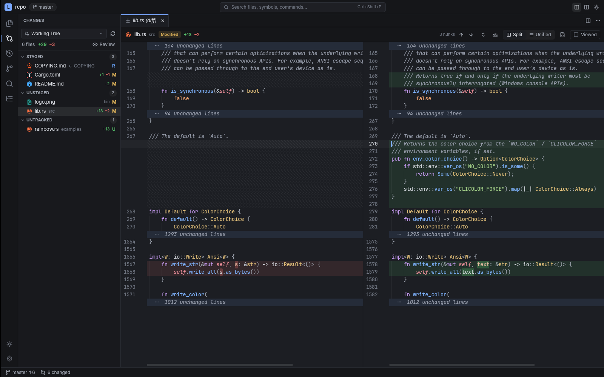
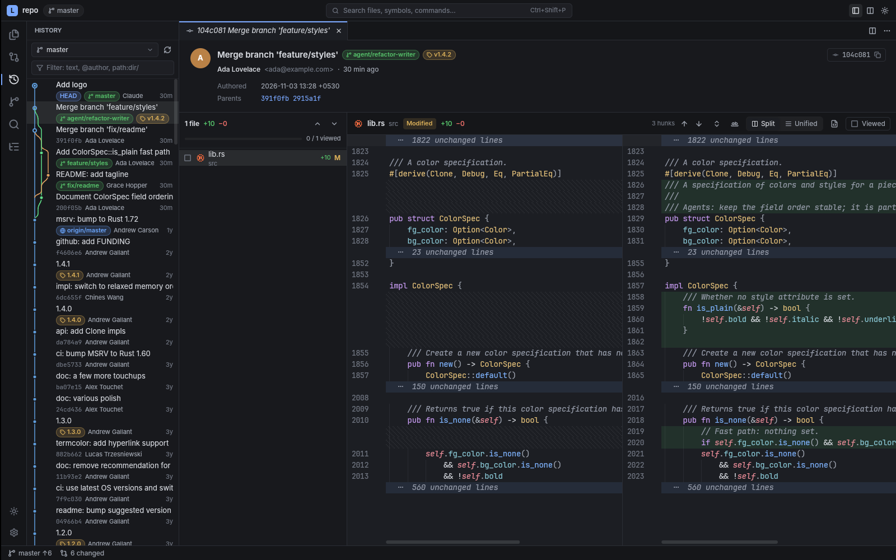
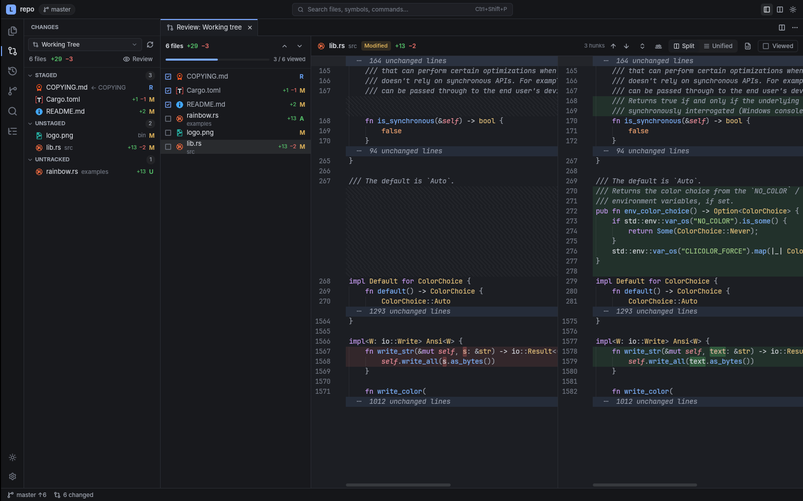
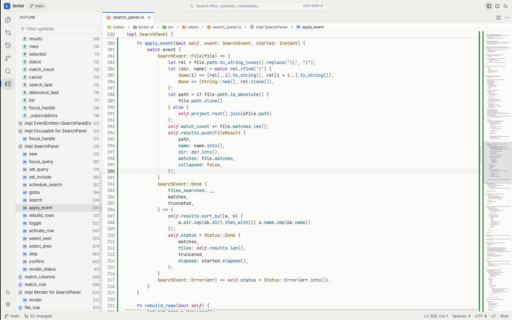
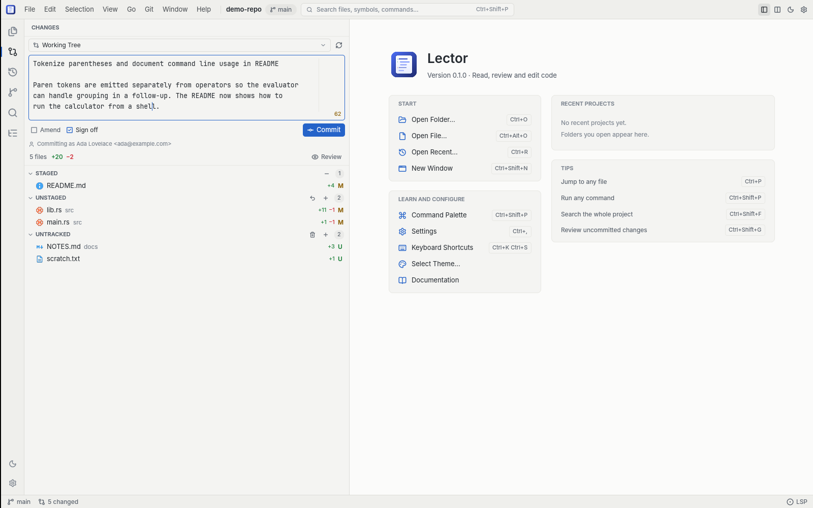
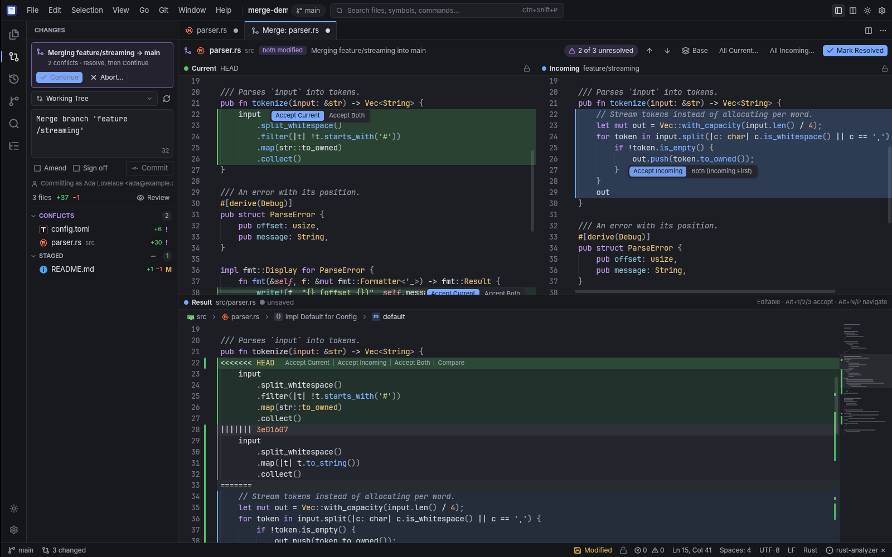
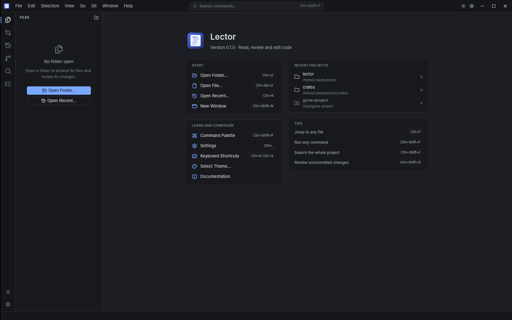
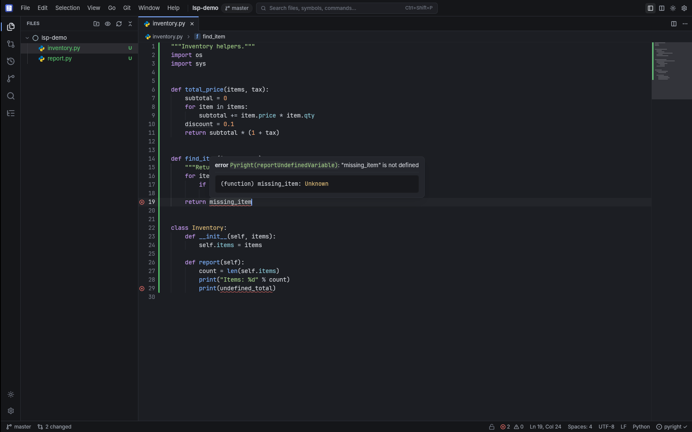

# Lector

**A fast, reading-first code viewer and git review tool, written in Rust.**

AI agents now write a large share of code; humans increasingly *read* and *review* it.
Today's editors are built for typing. Lector is built for reading: understanding an
unfamiliar codebase, following definitions, and reviewing changes — working-tree
edits, commits, branches, or whatever an agent just did.

Reading comes first, but you can act on what you read: stage and commit, make the small
fix, rename a symbol, resolve a conflict. Lector only writes when you explicitly ask it to
(save, stage, commit, discard, resolve) — browsing, diffing and blame never touch your files.



## Features (v0.3)

**Reading**
- Native, GPU-rendered UI (GPUI) with embedded JetBrains Mono and Inter fonts
- Tree-sitter highlighting for 23 languages, folding, indent guides, minimap
- Sticky scroll headers, breadcrumbs, outline panel, symbol pickers
- Go to definition, find references and hover — via your installed language servers,
  with a tags-based fallback that works with zero setup
- Fuzzy file finder (nucleo), command palette, project search (ripgrep's engine)
- Markdown preview, image preview, binary detection, instant opening of 1 GB+ files
- Live reload when files change on disk (e.g. while an agent works)
- Material file icons, light/dark/high-contrast themes, colorblind-safe diffs
- Session restore, keyboard and mouse parity, context menus everywhere

**Git review**
- Changes panel: staged, unstaged, untracked, conflicts; branch vs base; commit ranges
- Side-by-side and unified diffs with word-level highlights and folded context
- Review tab with per-file "viewed" checkboxes that reset when a file changes again
- History with commit graph, ref labels and filters; commit detail view
- Branches, tags and stashes; blame gutter; file and line history
- Permalinks for GitHub, GitLab, Bitbucket, Gitea/Codeberg, sourcehut
- Stage, unstage and discard files, hunks or selected lines; commit composer with amend,
  sign-off and hook output
- Merge conflicts: inline accept actions, three-way merge editor, Continue/Abort for
  merges, rebases, cherry-picks and reverts

**Light editing**
- Multiple carets, IME, undo/redo, auto-indent, comment toggling, line moves, find & replace
- Saves are atomic and keep encoding, BOM, line endings and permissions; unsaved-change
  prompts; files changed or deleted on disk are handled without losing work
- Language servers: diagnostics, format (and format on save), code actions, rename
- Read-only mode per tab or globally (`editor.read_only = true`)

**Everywhere**
- Menu bar on every platform (in the title bar on Linux and Windows), welcome screen with
  recent projects, keyboard shortcut viewer — every command is reachable by mouse or keys

| | |
|---|---|
|  |  |
|  |  |
|  |  |
|  |  |

## Download

Get the latest build from [GitHub Releases](https://github.com/meetdhruva/lector/releases/latest):

| Platform | Installers | Portable |
|---|---|---|
| Windows x64 / ARM64 | `…-setup.exe` (per-user or all users), `.msi` | `…-portable.zip` |
| macOS 11+ (universal) | `.dmg` | `.zip` |
| Linux x86_64 / ARM64 | `.deb`, `.rpm` | `.AppImage`, `.tar.gz` |

Builds are not code-signed yet. On macOS, right-click Lector.app → *Open* on first launch;
on Windows, SmartScreen may ask you to confirm. Every release includes `SHA256SUMS.txt`.

**Portable mode:** if a `lector-data` folder exists next to the executable, Lector keeps all
settings and state there (the Windows portable zip ships with it).

## Install from source

Requires Rust 1.88+ and `git` on `PATH`.

```sh
git clone https://github.com/meetdhruva/lector
cd lector
cargo build --release -p lector
./target/release/lector path/to/repo        # or: lector file.rs:42
```

Linux build dependencies (Debian/Ubuntu):

```sh
sudo apt install libxkbcommon-dev libxkbcommon-x11-dev libwayland-dev libvulkan-dev \
  libxcb1-dev libx11-xcb-dev libfontconfig-dev libfreetype-dev libssl-dev
```

macOS needs Xcode command line tools; Windows needs the MSVC toolchain.

## Usage

```
lector [PATH[:LINE[:COL]]] [--theme NAME]
```

| Action | macOS | Linux / Windows |
|---|---|---|
| File finder | `cmd-p` | `ctrl-p` |
| Command palette | `cmd-shift-p` | `ctrl-shift-p` |
| Project symbols / file outline | `cmd-t` / `cmd-shift-o` | `ctrl-t` / `ctrl-shift-o` |
| Project search | `cmd-shift-f` | `ctrl-shift-f` |
| Changes / History | `ctrl-shift-g` / `ctrl-shift-h` | same |
| Go to definition / references | `f12` / `shift-f12` | same |
| Back / forward | `ctrl--` / `ctrl-shift--` | `alt-left` / `alt-right` |
| Next / previous hunk (diff) | `alt-n` / `alt-p` | same |
| Mark file viewed (review) | `v` | `v` |
| Toggle blame | `cmd-alt-b` | `ctrl-alt-b` |

Settings live in `settings.toml` and `keymap.toml` in Lector's config directory
(run *Open Settings* from the command palette). A project can override settings in
`.lector/settings.toml`.

## Command line & MCP

The `lector` binary also works without a window, for scripts, CI and AI agents. The subcommands
never start the GUI (`lector status` answers in about 10 ms) and use the same core as the app: the
same commands, the same activity journal, the same undo.

| Command | What it does |
|---|---|
| `lector status [PATH]` | branch, ahead/behind, operation in progress (merge, rebase, ...), change counts |
| `lector changes [--staged\|--unstaged\|--branch BASE\|--range A..B]` | changed files with line stats and a **risk score with reasons**, riskiest first |
| `lector diff <changeset> [--file P] [--moved]` | hunks; `--moved` marks blocks that were moved, within a file or between files |
| `lector commands` | the command registry, with each command's argument JSON schema (`--json`) |
| `lector run <id> [--args JSON] [--allow-writes]` | run one registry command (writes need `--allow-writes`) |
| `lector activity` / `lector undo <id>` | what was written to your files or repository, by whom, and taking it back |
| `lector mcp [PATH] [--allow-writes]` | Model Context Protocol server on stdin/stdout |

```console
$ lector status
main → origin/main  ahead 1
staged 1 · unstaged 2 · untracked 1

$ lector changes
Working tree · 3 files, +5 -2 · 1 high
HIGH 0.56 M src/lib.rs  +3 -2  Changes the signature of public function `a`: `pub fn a()` -> `pub fn a…
low  0.00 M README.md   +1 -0
low  0.00 A src/new.rs  +1 -0

$ lector diff HEAD~1 --moved --file src/parser.rs
$ lector run git.list_changes --args '{"changeset":"staged"}' --json
$ lector run git.stage --args '{"paths":["src/lib.rs"]}' --allow-writes
Staged src/lib.rs
journal #7 (undo with `lector undo 7`)
```

A changeset is `worktree`, `staged`, `unstaged`, `untracked`, `commit:<sha>`, `range:<a>..<b>`,
`branch:<base>...<branch>`, or simply a revision (`HEAD~1`, a tag, a sha) or `A..B` / `A...B`.
Run in another folder with `-C DIR`.

**Output.** Human output is compact; colors only on a terminal (`--color auto|always|never`, and
`NO_COLOR` is respected). `--json` output is stable: every document carries `"schema": 1`, fields are
only ever added, and paths are repository-relative with 0-based lines (see
[`docs/ARCHITECTURE.md`](docs/ARCHITECTURE.md#cli-and-mcp-v05-as-implemented) for the formats).
Exit codes: `0` ok, `1` error, `2` usage error. `lector changes | head` is fine (a closed pipe is not
an error). Gate a CI job on risk:

```sh
lector changes --branch origin/main --json | jq -e '.totals.high == 0'
```

**Writes.** Reading, diffing and `lector mcp` without flags never write. A command that changes your
files or repository only runs with `--allow-writes`; it is recorded in the journal with its origin
(`cli`, `mcp`, ...), and `lector undo <id>` restores what it overwrote (it refuses if you edited the
files since; `--force` restores anyway, backing the current state up first).

### Use Lector from an MCP client

`lector mcp` speaks the [Model Context Protocol](https://modelcontextprotocol.io) over stdio
(JSON-RPC 2.0, protocol revisions 2024-11-05 to 2025-11-25). Every registry command is a tool
(`git.list_changes` → `git_list_changes`, `git_show_diff`, `git_blame`, `document_read`,
`search_project`, ...) with the command's JSON schema; results come back as structured content plus a
short text summary. Open documents and changesets are resources
(`lector://document/<path>`, `lector://changeset/<key>`). The tool list always reflects the registry.
Tools that write are neither listed nor callable unless the server was started with `--allow-writes`;
the others are annotated `readOnlyHint` / `destructiveHint`.

Claude Code:

```sh
claude mcp add lector -- lector mcp /path/to/repo
claude mcp add lector-rw -- lector mcp /path/to/repo --allow-writes   # may stage, commit, save...
```

Any MCP client (`.mcp.json`, Claude Desktop, Cursor, ...):

```json
{
  "mcpServers": {
    "lector": { "command": "lector", "args": ["mcp", "/path/to/repo"] }
  }
}
```

The server works on the folder you pass (default: the current directory), keeps all its logs on
stderr and exits when the client closes stdin. Writes made through it show up in Lector's
*Activity* panel and in `lector activity` with origin `mcp`, and can be undone from there.
On Windows the installers also provide `lector.com` / `lector-cli.exe`, console builds of the same
command line (the GUI `lector.exe` has no console of its own); use `lector` in a terminal as above.

## Architecture

Lector is a Cargo workspace of small crates. Everything below the UI is UI-free,
synchronous, and reusable on its own:

| Crate | Purpose |
|---|---|
| `lector-text` | SumTree, rope, memory-mapped text, coordinate conversions |
| `lector-syntax` | tree-sitter language registry, highlights, outline, folds, tags |
| `lector-diff` | line diff (imara-diff histogram), word refinement, split/unified rows |
| `lector-search` | gitignore-aware walker, fuzzy picker (nucleo), project grep |
| `lector-git` | git reads via gitoxide; blame, history and all writes via the git CLI |
| `lector-lsp` | LSP client without an async runtime (navigation, diagnostics, edits) |
| `lector-buffer` | editing model: multi-cursor selections, edit operations, undo/redo |
| `lector-fs` | file loading, encoding and kind detection, debounced watcher |
| `lector-config` | settings, keymaps, paths, session and review state |
| `lector-theme`, `lector-icons` | theme model and built-in themes; file and UI icons |
| `lector-workspace` | UI-free app model: project, documents, navigation, review |
| `lector-ui`, `lector-ui-git` | GPUI shell, widgets and views |

See [docs/ARCHITECTURE.md](docs/ARCHITECTURE.md) for contracts and design rules,
[docs/PERFORMANCE.md](docs/PERFORMANCE.md) for release-gate measurements, and
[docs/RELEASING.md](docs/RELEASING.md) for how releases are built.

## Roadmap

| Release | Scope |
|---|---|
| ✅ 0.2 | Stage/unstage hunks, discard, commit composer, menus and welcome screen |
| ✅ 0.3 | Editing, multi-cursor, formatting, LSP code actions, conflict resolution |
| 0.4 | Full accessibility (screen readers via AccessKit) |
| 0.5 | Agent integration: ACP client, MCP server, headless CLI |
| 0.6+ | WASM plugins, PR integration, stacked changes, structural diff |

## License

Dual-licensed under [MIT](LICENSE-MIT) or [Apache-2.0](LICENSE-APACHE), at your option.
Bundled fonts, icons and grammars keep their own permissive licenses; see
[assets/THIRD_PARTY.md](assets/THIRD_PARTY.md), `crates/lector-icons/THIRD_PARTY.md`
and `crates/lector-syntax/GRAMMARS.md`. Release artifacts also include the full license
texts of all Rust dependencies (`third-party/CRATES.md`, generated with cargo-about).
